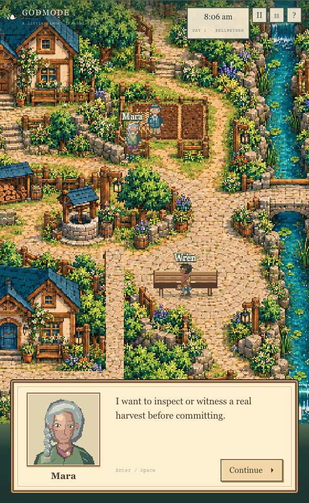
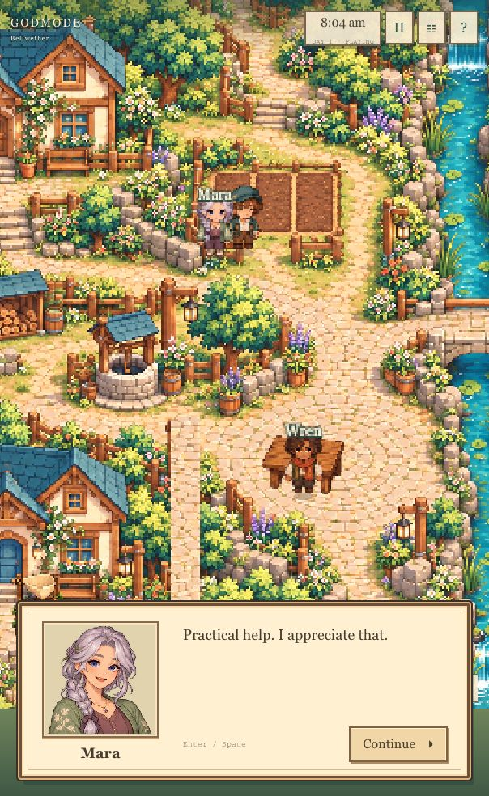

# GODMODE

**The era of finished software is ending.**

*In the future, you won't just play the game. You'll change what the game is.*

Grow wheat, get to know three neighbors, and change who organizes the harvest festival. Carry real supplies, watch people take on food, setup and invitation work, then branch the record and try another rule. GODMODE is a secular cozy game by **Ryan Morrison — founder of Built by Magnus LLC, Creative Director at North of Common Capital, and independent developer**.

The larger thesis is a living world whose rules you can propose in your own words, review as concrete changes, and then observe in play. Earlier local Qwen runs verified bounded rule interpretation and a resident-authored cooperative charter, with explicit Apply and recorded physical consequences. The current configuration selects Meta, with credit authorization false and no silent Qwen fallback. Muse adapters are fixture-tested; actual Meta calls remain zero. Routine physical work remains deterministic. The 21 historical local Qwen calls are not Meta evidence.

**October 25, 2026 snapshot: the new cozy slice is LOCAL ONLY at the user’s explicit request, “Keep it local for now.” Final hackathon submission is ON HOLD.** The user authorized a public GitHub source mirror for inspection: [d5dtgpt59z-cell/godmode](https://github.com/d5dtgpt59z-cell/godmode). Hosted deployment, schedules, new credentials and final submission remain on hold. The earlier owner-private Bellwether release remains unchanged. This prototype and its assets began before the announced October 26 event start; pre-event eligibility and the policy treatment of the replacement application remain unconfirmed. See [COMPLIANCE.md](./COMPLIANCE.md) and [SUBMISSION-DRAFT.md](./SUBMISSION-DRAFT.md).

**Current event application: GODMODE — received, Pending.** On October 25, the user explicitly authorized replacing Worldlift. The native Worldlift unregister action succeeded at **22:55:36.993 UTC**; the subsequent corrected GODMODE application showed **“Successfully applied to event”** and **Pending**, and View Application displayed the new black-command-line pitch. That pitch discloses the pre-event foundation and pending Muse access. The historical Worldlift receipt remains preserved. Receipt is not admission, organizer approval of a pivot, or eligibility clearance; final project submission remains on hold.

## Current local milestone — October 25

The entry now opens on a black command line. Describe a universe, review a validated Muse blueprint, then explicitly create a separate paused world. **Live Muse creation is blocked until verified Meta access is available.** The entry preserves descriptions and saved-world access; it does not substitute a preset or Qwen output. A blueprint currently changes three resident profiles, the first personal agent's values and existing rules on the fixed neighborhood map. It does not generate arbitrary mechanics or terrain.

An optional engine3 branch gives the first personal agent persistent values, relationships, evidence-backed beliefs, wishes, capability requests and short executable plans. Real hunger and fatigue interrupt plans; in-person ideas are attributed evidence, not compulsory instructions. Composable activities add physical invitations, individual choices, travel, timed gestures, finite transfers and consumption. Registered image-generated mushrooms, rain catchers and benches can enter the physical world; nearby inhabitants discover them privately. Rain-catcher water is finite and conserved. The image-generation transport adapter is separately gated and fixture-tested; live image-service delivery is not wired into this local game.

The first-minute guide follows actual planting, watering, growth, harvest and gifting state. **Town rules → Direct changes** offers readable activity and object authoring without a model; preview and Apply remain explicit. Raw JSON is behind Developer inspection. **Moments you noticed** includes only player-observed saved events and follows explicit evidence links without exposing private thoughts. Narrow-view notebook Close remains reachable after scrolling.

The art replacement uses original image-generated portraits, four-direction character animation, map and foreground assets with retained raw images and technical packing provenance. Existing art, engine1/2, recordings and Bellwether remain preserved. Three starting villagers meet the requested ceiling of ten; dynamic ten-character generation is not implemented.

Current integrated verification: **256/256 tests**, typecheck, scoped lint and final production build passed. The [readiness report](./quality/readiness/VERIFICATION.md) retains actual native gameplay, saved reload, exact replay and screenshots; [test results](./quality/readiness-tests.tap) retain the full count. Earlier evidence remains in `quality/personal-agent/`. See [current source and evidence](./PROJECT-INSPECTION.md), [architecture/design audit](./docs/PERSONAL-AGENT-AUDIT.md), and [Meta access and eligibility status](./docs/META-STATUS-20261025.md). Historical verification counts below describe earlier milestones.

## Historical emergence milestone — preserved evidence

**Emergence foundation:** open the journal in an existing neighborhood, choose **Start a living branch**, then Play. The original save is preserved, with its original engine. The new branch can retain model-authored charters, physically delivered proposals, independent consent, an association, owner permission and real finite work. Slow inference runs outside movement and tick queues. Pausing stops new dispatches and retains in-flight results for safe recovery.

In fresh native-browser gameplay, Wren proposed **Morning Square Gathering** without a player-written proposal. Ada joined; Mara required harvest evidence. After owner approval, Ada and Wren physically delivered four grain, consumed one timber preparing the square, and completed a two-person meal. Mara joined after witnessing the player's harvest. Her recorded causal references point to the delivery and harvest. Four actual browser Qwen calls produced one charter and three waits; a separate ordinary-state service evaluation made one additional real call. None used Meta or paid inference. The recording replayed exactly at 534.8 seconds and survived reload.

See [audit and migration plan](./docs/EMERGENCE-PLAN.md), [actual browser evidence](./quality/emergence-browser-qa.json), [replayable recording and raw model receipts](./quality/emergence-browser-recording.json), and [official-rules/Meta status](./docs/META-STATUS-20261025.md). That milestone passed **147/147 tests**, typecheck, scoped lint and its local production build; historical evidence is in `quality/emergence-*`.



This is one executable shared-gathering capability, not a general civilization intelligence. Charters are immutable, membership has no leave mechanism, and associations share the existing festival resource account. General belief propagation, rich pairwise relationships, new occupations, death and broad terraforming are not implemented. The next development focus is one deeper, embodied resident before scaling that intelligence to the rest of the town.

The current cast uses original image-generated cozy/anime portraits and matching four-direction sprites, with [raw images and packing provenance](./art/cozy/imagegen-v4/README.md). The earlier Aseprite cast and portrait evidence below remain preserved. When an NPC actually speaks to the player, the game shows that speaker’s portrait and literal recorded line in a dialogue box. Continue/Enter returns control; reading locks movement. Old dialogue is not replayed on load. Previous casts and all saved worlds remain preserved.



The earlier portrait capture remains at `quality/portrait-dialogue-desktop.jpg`.

Start with [PROJECT-INSPECTION.md](./PROJECT-INSPECTION.md) for the source map, current verification and limits. The GitHub copy is for source inspection; the playable preview remains local and final hackathon submission remains on hold.

## Play and preserved work

| Working-tree route | Experience |
|---|---|
| `/` | New cozy neighborhood; the primary game entry. |
| `/play` | The same cozy game. |
| `/bellwether` | Preserved 24-resident experiment/continuing-town interface. |

The cozy loop is plant → water → harvest → give a gift → change a festival rule → observe the response. Ada, Mara and Wren have individual needs, goals, trust, preferences and bounded memories. Routine activity, charter responses and dialogue use recorded resident policy; a living branch separately admits bounded model-authored initiatives. Food, timber, seed protection, work duration, movement, invitations and flood routing belong to the physical simulation.

Use click-to-walk or WASD/arrows, the garden tools, journal and Town rules. The exact editor supports organizer, venue, food target, seed reserve and bounded low-path flooding. Preview shows the actual diff before Apply. Revert changes rules prospectively; historical Undo creates a separate branch using the exact operation prefix. Harvests, spent goods and memories are not erased from the original timeline. Unsupported language requests cannot create new mechanics.

The old `lib/sim/` engine, routes and saves remain intact. The cozy engine is separate in `lib/cozy/`; server/API additions use separate cozy tables. Preservation artifacts are the Git tag `godmode-before-cozy-20261025`, sibling [Git bundle](../godmode-before-cozy-20261025.bundle), and [local world backup](../godmode-local-world-backup.json). The earlier [56-second film](./demo/godmode-prototype-56s.mp4) remains a legacy artifact, superseded for the current pitch.

## Current release and evidence

- **Cozy local implementation:** farming, four actors including the player, three NPCs with needs/goals/memories, gifts, physical festival tasks, bounded floods, typed rule proposals, apply/revert, exact Undo, comparison, save/export/replay and real clock debt.
- **Local verification:** [256/256 tests](./quality/readiness-tests.tap), [typecheck](./quality/readiness-typecheck.log), [scoped lint](./quality/readiness-lint.log) and [final production build](./quality/readiness-build.log) passed. [Actual browser QA](./quality/readiness/VERIFICATION.md) verified direct finite-object introduction/collection, planting, watering, harvest, physical gifting with portrait dialogue, observed-history links and paused saved reload. The final recording replays exactly with zero new model calls. Earlier 95-, 104-, 147- and 220-test evidence remains historical; it is not a substitute for this release’s checks.
- **Input timing:** command transactions consume owed 100 ms steps under the previous intent before recording a new command. 100/200 ms move-stop tests and actual local HTTP testing establish authoritative movement/replay. Duplicate commands consume nothing again; more than 60 seconds of debt returns `COZY_CATCH_UP` until bounded ticks flush it.
- **Historical film:** the completed [72-second cozy prototype](./demo/cozy/godmode-cozy-prototype-72s.mp4) and [editable source ZIP](./demo/cozy/godmode-cozy-demo-source.zip) passed source/recording audits and visual review of encoded contact sheets. It presents recorded rule-policy states with editorial timing, not footage of product controls or live Meta. Its generated MP4 is retained locally and excluded from Git; editable source/recordings are included. It predates the current image-generated cast, black entry and direct composer. The [new 80–90 second capture plan](./docs/GODMODE-PLAYABLE-DEMO-PLAN.md) is a plan only; no new MP4 has been rendered. Official final-video requirements remain unknown. See [film provenance](./demo/cozy/README.md).
- **Deployment:** the native receipt for the older private release is `appgdep_6ade24250c848191a27a50675c8972d7`, source commit `c80fd18c94fda81a069369d93f857edd5bf31fc7`, October 25 at 15:45:51 UTC. [Private Site](https://godmode-by-magnus.magnusrobot.chatgpt.site/) access requires supported authentication. The cozy build remains local only; The public GitHub mirror provides source inspection; no hosted deployment is authorized. That receipt belongs only to the unchanged legacy release.
- **Background:** bounded service-capable writers exist. No active native schedule or successful unattended cozy tick has been verified. Browser-driven updates are not unattended operation. The local-only instruction excludes creating a hosted schedule.

## Local setup and reproduction

Use Node.js 22.13 or newer. Local tests use Node SQLite; hosted routes use D1. The project retains the Sites/Vinext framework integration.

```sh
npm run install:ci
npm run build
```

After a fresh build creates `dist/server/wrangler.json`, apply only pending local migrations, in order:

```sh
node --import ./scripts/sites-env.mjs ./node_modules/wrangler/bin/wrangler.js d1 execute DB --local --config dist/server/wrangler.json --persist-to .wrangler/state --file drizzle/0000_abnormal_ezekiel_stane.sql
node --import ./scripts/sites-env.mjs ./node_modules/wrangler/bin/wrangler.js d1 execute DB --local --config dist/server/wrangler.json --persist-to .wrangler/state --file drizzle/0001_lying_siren.sql
node --import ./scripts/sites-env.mjs ./node_modules/wrangler/bin/wrangler.js d1 execute DB --local --config dist/server/wrangler.json --persist-to .wrangler/state --file drizzle/0002_white_gabe_jones.sql
node --import ./scripts/sites-env.mjs ./node_modules/wrangler/bin/wrangler.js d1 execute DB --local --config dist/server/wrangler.json --persist-to .wrangler/state --file drizzle/0003_new_satana.sql
node --import ./scripts/sites-env.mjs ./node_modules/wrangler/bin/wrangler.js d1 execute DB --local --config dist/server/wrangler.json --persist-to .wrangler/state --file drizzle/0004_boring_pestilence.sql
node --import ./scripts/sites-env.mjs ./node_modules/wrangler/bin/wrangler.js d1 execute DB --local --config dist/server/wrangler.json --persist-to .wrangler/state --file drizzle/0005_orange_bushwacker.sql
npm run dev
```

Migrations 0000–0005 are already applied to this workspace's local preview. Do not replay or edit them. A fresh database is separate. New schema changes append a Drizzle migration; handlers never run DDL. `npm start` previews the built Worker locally and does not deploy it. **Keep this build local under the current user instruction.** GitHub source export is authorized for inspection; hosted migrations, deployment, schedules and credential changes remain outside this step. The existing private legacy Site stays unchanged.

Use the printed loopback address; current local QA uses port 4318. New cozy saves start paused. `POST /api/cozy {seed?,fresh:true}` creates another independent neighborhood without changing the primary or older saves. The Help action “New neighborhood · keep this one saved” uses this path.

```sh
npm test
npm run typecheck
```

The earlier social-charter release passed 147 tests, typecheck, scoped ESLint and the local production build. See `quality/emergence-{tests.tap,typecheck.log,lint.log,build.log}`. Earlier `quality/current-refinement-*` records the preceding 104-test character/dialogue release. Fresh living-branch gameplay verified original farming, physical delivery, differing responses, permission, real cooperative work, an evidence-backed change of mind, saved reload and exact replay. Preserve the final local source/package hashes and retained recording/archive lineage. The completed film’s replay/render/encoded-frame checks are documented in `demo/cozy/README.md`. A finished local artifact does not establish official submission-format compliance.

## Server, persistence and provenance

[cozy-api.ts](./lib/server/cozy-api.ts) documents the exact HTTP contract; [cozy-contract.ts](./lib/server/cozy-contract.ts) contains client DTOs. `/api/cozy` creates/loads the main save, `/:id/command` applies validated actions, `/:id/tick` consumes bounded owed time, and rule endpoints separate preview, real-model proposals, Apply and Revert. Import/replay/fork/compare/archive endpoints preserve explicit provenance. Exact Undo supplies an operation index and history-origin hash, preserving prior same-step actions.

Cozy physics uses fixed 100 ms steps. State, command receipts, clock debits and audit records commit through SQL lease/CAS transactions. 100 ms is the authoritative input resolution. GET never advances. Saved heads/archives are capped at 1.8 MB, recording work is bounded, and older segments are retained before checkpoint replacement. Existing-database upgrade, restart, concurrency, no-double-dispatch, conservation and replay checks are included. Hashes establish deterministic consistency, not signatures or proof that a provider generated an imported claim. Hosted CPU/resource suitability remains a separate verification.

Production writes require the trusted creator identity and preserve the Site's owner-private audience. Only bounded tick writers additionally support the existing private Sites service boundary. Service access is not visitor identity and cannot authorize rule editing. No source file or client response contains a key value.

| Server binding/gate | Current status |
|---|---|
| `DB` | Required D1 storage. 0004 adds separate cozy tables and a shared model-job purpose defaulting to `resident`. |
| `CREATOR_EMAIL` | Privately configured from the native Site owner. |
| `MODEL_API_KEY` | Absent; no key created. |
| `GODMODE_PROJECT_BUDGET_MICRO_USD` | Absent; a positive explicit project cap is required for model calls. |
| `GODMODE_RULE_AUTHORING_ENABLED` | Meta natural-language interpretation is unavailable; the earlier local Qwen path remains separate and is not an active fallback. |
| `GODMODE_COZY_NPC_ENABLED` | Optional Meta plans for the three NPCs remain off/unconfigured. |
| `GODMODE_LIVE_ENABLED` | Legacy resident live mode remains false. |
| `GODMODE_BACKGROUND_ENABLED` | Writer gate only; never proof of a schedule or unattended execution. |
| `GODMODE_LOCAL_QWEN_ENABLED` | Explicitly true only in local `.dev.vars`; adapter also requires development mode. |
| `GODMODE_LOCAL_QWEN_MODEL` | Existing approved `qwen3.5:9b` tag and observed digest; no downloads or remote fallback. |
| `GODMODE_LOCAL_INITIATIVE_ENABLED` | Separate development-only opt-in for resident proposals; enabled in this local preview. No browser-closed scheduler. |

Historical Qwen authoring used fixed server-only loopback Ollama with JSON schema, 4096 context, 768 output, thinking off, 90-second deadline, one active local generation and durable request receipts. Five actual held-out service requests passed: three supported changes and two honest unsupported outcomes. Local calls/provenance are separate from Meta; Meta budgets remain untouched. Those receipts precede the current Meta selection; they do not establish currently available authoring or authorize switching providers. See [actual receipts, limits and verification](./quality/local-qwen-verification.md).

Resident initiatives share the one local generation slot and 100-attempt allowance per save with local rule interpretation. They additionally cap dispatch at 12 per save per wall hour and use a 30-simulation-second resident cooldown. These are per-save limits, not a global lifetime inference budget. Immutable tickets retain the own-observation snapshot and raw provider receipt. Accepted decisions are replayed without inference. A new tab can recover an existing ticket without accidentally admitting another generation. Already admitted requests may finish after a page closes; no ongoing browser-closed evolution is claimed.

The implemented hosted adapter requests `muse-spark-1.3` with exact token preflight, 2,000 input tokens, 768 total output tokens including reasoning, minimal effort and strict schemas plus current-world validation. Rules produce proposals, never automatic application. NPC plans use individual received evidence and actual task/resource limits. No model inference runs continuously inside ticks. All transport tests use labeled fixtures.

Model requests share the existing project ledger and six-generation concurrency limit. Cozy saves retain 500 generation attempts/1,000 count-plus-generation HTTP requests / $3 reservation limits. Unknown outcomes stay conservatively charged in the application ledger; retries do not blindly resend an attempt. These controls are not a provider-enforced spending guarantee. [Token counting](https://dev.meta.ai/docs/token-counting), [reasoning](https://dev.meta.ai/docs/reasoning), [structured output](https://dev.meta.ai/docs/structured-output).

A local **Llama 3.2** alternative was researched because the event lists Meta open weights. It has **not been downloaded, accepted or used**. The user chose existing Qwen for now; no Llama agreement was accepted. Separate consent would be needed if that choice changes. “Keep it local for now” does not authorize accepting this license or downloading a model. Acceptance would still leave integration and real behavior tests to do; it would not connect the hosted NLP surface by itself. Hosted interpretation currently needs a verified provider path. No billing or purchases have occurred.

## New art and retained media

The current v3 cast/portraits are in [character-refinement/v3](./art/cozy/character-refinement/v3/README.md); the broader production set is [art/cozy/](./art/cozy/README.md) and `public/assets/cozy/`: a 512×384 fixed environment, four 24×32 character sets with 288 poses / 96 clips, and separate crop/gift/goods/festival/flood overlays. It is not a modular architecture tileset. Geometry masks and visual anchors are audited against interaction targets.

The environment derives from the original project concept and **two built-in image-edit calls**, followed by native Aseprite resize/palette work and authored path clearance. The earlier concept used one separate image-generation call. Characters and foreground sprites were constructed natively with Aseprite/Lua; no remote character-generation calls or protected game raster imports were used. This supersedes earlier blanket “no image generation” wording for the project's new background. See [runtime provenance](./public/assets/cozy/provenance.json), [archived first-pass source manifest](./art/cozy/ART-MANIFEST.json), [first-pass art source zip](./art/cozy/cozy-art-source.zip) and [current v3 audit](./art/cozy/character-refinement/v3/v3-report.json).

The asset room is `/assets/cozy/viewer.html`; it stages art, not gameplay. The older sprite pack and 56-second film remain preserved as earlier-revision artifacts. No separate public asset-pack license is granted by these manifests. Dependency/asset rights and required AI-assistance disclosures still need final review.

## Submission boundary

The current **GODMODE** application was received with **Pending** status after the user-authorized withdrawal of Worldlift on October 25. The saved native application shows GODMODE; the older Worldlift application and withdrawal records are preserved as history. Admission, the replacement/duplicate-policy interpretation, organizer approval of the project change, final selected-participant rules, permitted prior work and final portal fields remain unresolved. Current code/art dates are October 25, before the announced October 26 start. Preserve those dates and comply with later disclosure/rebuild requirements.

The intended final pitch now follows the cozy loop and validated-rule thesis. Actual eligible Meta behavior, the official final-video format, final source package, judge access and field-by-field compliance still need evidence. **Final submission remains ON HOLD under the user's explicit instruction**, even if a later private deployment or preparation milestone succeeds.
