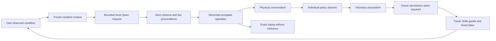

# GODMODE: emergence foundation

Audit and implementation plan, October 25, 2026. Baseline: `0018514369a97f213a38f1be42355cf339d2ce22`; 104 passing tests and a verified local build. This document describes the selected milestone, not a claim that the larger civilization vision is implemented.

**Thesis:** The era of finished software is ending.

**Tagline:** In the future, you won't just play the game. You'll change what the game is.

## Audit

| Area | Existing implementation | Smallest extension |
|---|---|---|
| Physical world | Fixed 100 ms engine, BFS movement, finite inventories, wheat, rain catchment, bounded flooding, resource reservations and physical festival work | Reuse these operations for collective commitments. No new physics engine. |
| Residents | Three stable identities, needs, weighted goals, private memories, scalar player trust/affinity and observed festival state | Add private observations, received proposals, evidence-backed stances and resident-to-resident social state. Do not expose one resident's unseen information to another. |
| Behavior | Autonomous deterministic activity; festival roles currently selected by resident ID | Use goal/need/evidence scoring for cooperative work in the new engine epoch. Preserve original behavior for existing recordings. |
| Language | Real local pinned Qwen interpretation, strict schemas, validated previews, explicit Apply and durable receipts | A separate bounded resident-decision capability and job purpose. The player does not type the resident's proposal. |
| Social structures | Festival participants and invitations; no persistent institution or independent membership model | A composable voluntary association with a supported shared-gathering capability, a charter, membership, practices, leadership, a physical resource account and history. |
| History | Exact replay, fork, Undo, archived checkpoints and imported-audit separation | Version dispatch, captured old golden recordings, explicit evolution forks and recorded accepted social operations. No model calls during replay. |
| Presentation | Phaser village, original v3 sprites/portraits, real-event dialogue, tools and notebooks | A living branch entry, foreground initiative progress, actual proposal/permission controls, independent stances, group commitments and collapsed causal evidence. |
| Persistence | D1/SQLite save heads, lease/CAS, command/clock receipts and bounded updates while the page is open | Immutable resident tickets and short post-inference commits. No lease held during generation and no new background service. |
| Legacy | Original 24-resident Bellwether, prior art, films, saves and test evidence | Preserve unchanged. |

## Selected milestone

A resident notices a condition they actually observed, then may ask Qwen to propose a cooperative charter, inspect something, share a concern or wait. Qwen can choose the name, supported charter parameters and explanation. The engine validates the result against that resident's frozen knowledge and the implemented capability.

The first executable project family is **shared gathering**, because its resources, travel, reservations and work already exist. This is a bounded capability, not a prewritten Harvest Circle story. No institution name, founder, unanimous response or successful outcome is guaranteed.

Neighbors must receive the proposal before responding. Their recorded rule-policy stances can be join, conditional or decline, based on individual needs, goals, trust and evidence. Two consenting residents can form an association. Conditional support is not membership. Group formation alone moves no resources.

When the current world rule reserves organizing authority to the player, a resident asks for permission. The player sees the actual proposed effect before approval. Refusal is retained in history; it does not erase the association or its beliefs. Supported collective work requires actual stock, protected seeds, a traversable route and labor. Institutions remain inspectable beyond one gathering and can affect subsequent activity.

## Architecture and migration

The existing runtime is React 19.2.6, Phaser 3.90, TypeScript and Vinext/Vite, with Drizzle over local SQLite/D1. Keep those dependencies. No new renderer, agent framework, database service or inference package is needed for this milestone.

| Layer | Source | Responsibility |
|---|---|---|
| Preserved physical/replay epoch | `lib/cozy/v1/` | Frozen original contracts, initialization, engine and replay. Golden recordings establish unchanged old hashes. |
| Versioned physical/social engine | `lib/cozy/{contracts,world,engine,replay}.ts` | Explicit upgrade, private knowledge projection, bounded initiative validation, proposal delivery, consent, association persistence and real tasks. Existing initialization still creates v1. |
| Async coordination | `lib/server/cozy-initiative.ts`, `cozy-meta.ts`, `cozy-store.ts` | Immutable admission snapshots, pinned local inference, durable lifecycle receipts, limits and short post-generation commits. |
| Storage and HTTP | `db/schema.ts`, `drizzle/0005_*.sql`, `app/api/cozy/[id]/` | Additive ticket table and explicit evolve/pump/social-decision endpoints. GET does not migrate or advance a world. |
| Foreground presentation | `components/cozy/` | Separate initiative request coordinator, living notebook, actual rule preview, journal, resident inspection and existing event-driven portrait dialogue. |
| Original experiment | `lib/sim/`, `/bellwether` | Preserved independent 24-resident simulation and its existing API/storage. |

An evolution fork copies the current world into `cozy-engine-2` / `cozy-cooperation-1`, records its v1 parent hash and starts paused. The save and recording envelope remains version 1; the engine/content pair dispatches behavior. The original save is retained. V2 checkpoints include the full bounded social state; accepted decisions are operations, while model receipts retain the frozen input and raw provider output separately. Imported provenance is an imported claim, not proof of a fresh model call.

The trust boundary is between a model suggestion and an engine operation. A proposal's name, purpose and explanation are attributed text. A delivery, consent, collection or completed task exists only after an authoritative operation or physical tick emits it. The model cannot execute code, invent inventory, install mechanics or grant itself permission.

For now, a social stance is a recorded position on one charter. It is not a general belief/rumor simulator. Current trust/affinity scalars primarily describe the player relationship; rich pairwise loyalties, cultural institutions, death, new professions, legal systems and migration remain later work. The generic association record creates an extension point, but its only executable practices in this milestone are the existing gathering activities. A model-generated institutional name does not implement additional powers.

## Stages and acceptance gates

1. **Preserve and version.** Freeze the old cozy implementation, capture golden baseline/checkpoint/fork recordings, and add an explicit paused evolution fork. Original saves remain usable; GET never migrates. Old hashes must reproduce exactly.
2. **Resident initiative.** Admit one bounded model job from an engine-selected observed opportunity. Save its context, trigger, intent/rule version, model receipt and outcome. The world continues ticking during inference. Wait, inspect, invalid, unavailable and stale results are honest outcomes.
3. **Social influence.** Deliver a proposal physically, record who received it, and compute differentiated stances from each person's own information. Tests must show that unseen evidence cannot change a response and that changed needs/trust/evidence can.
4. **Group formation.** Persist a generic association only after sufficient actual consent. Test two-member formation, one-member failure, conditional support and retained membership after save/reload and a later gathering.
5. **Physical consequences.** Reuse real food pickup/delivery, timber consumption, setup time, invitations and movement. Test shortages, seed protection, floods and conservation. No supplies appear because a model described them.
6. **World-rule expansion.** Keep the current validated rules and working physical flood as the demonstrable environmental subset. Broader terrain, gravity, land law, immortality, death, religion and new mechanics remain unsupported until separate engine capabilities exist.
7. **Evidence.** Run the old suite plus version, knowledge, consent, material, async/idempotency and persistence/replay tests. Capture a real Qwen trace and actual local gameplay separately from fixtures and editorial footage. Report the selected development and its causal chain, including failures.

## Model and execution boundaries

- Existing local `qwen3.5:9b` only; no additional weights, credentials, paid calls or Meta fallback.
- New initiative mode is explicit and development-only. It is driven by an open running local game, not a hosted schedule or browser-closed daemon.
- One shared local generation slot, stable request receipts, conservative unknown-outcome quarantine, per-resident simulation cooldown, at most 12 initiative calls per save per wall hour, and a bounded total shared with local rule requests.
- Physical ticks never invoke a model. Admission and accepted results are recorded; slow generation runs outside the world lease and client command queue.
- Revalidation checks changed intent, permission and relevant physical facts. Unrelated clock revisions must not make every asynchronous result stale.
- Untrusted model output is data. No generated executable code, fabricated events, automatic global belief updates or inference during replay.
- Social responses and physical fallback policy remain labeled as deterministic policy; a real model-authored founder proposal does not make every resident action model-generated.

## Preservation and delivery

The original main branch and public inspection repository are retained. Work begins on local `codex/living-world-initiative`, with tag `godmode-before-emergence-20261025`, a Git bundle and a consistent local save snapshot. Existing artwork and dialogue stay in place. No new hosted deployment, automated background service, paid provider, credential change or final hackathon submission is authorized.

Official rules, the Worldlift application pivot and pre-event-work eligibility require fresh evidence. The local Qwen milestone must not be presented as demonstrated eligible Meta technology.

## Next milestone: one convincing resident

User steering after the first implementation: deepen one resident's intelligence and needs before extending it to the others. Use Wren as the first candidate. This section is a plan, not a claim of implemented human-like intelligence.

Further clarification: the desired world lets characters and players dream up things the developer did not enumerate. Do not turn this milestone into a bigger menu of authored activities. Wren's aspirations should allow open-ended ideas, persist across time, and generate conversations, experiments and capability requests. The engine must distinguish imagining, proposing, attempting, being blocked and actually accomplishing something.

The existing engine already stores hunger, energy, social need, weighted goals, trust/affinity, private memories and physical intentions. The next increment should make those compete in a coherent individual decision loop, rather than add more institution types.

1. **Persistent personal state.** Keep an embodied needs model, stable preferences and values, known relationships, beliefs with evidence/confidence, open-ended aspirations, a small active-goal stack and an unfinished plan. Separate durable identity from current mood, inferred beliefs and physical facts. Avoid unsupported medical or psychological claims.
2. **Bounded perception.** Wren knows what he observed, was told, remembers or believes. A belief can be mistaken. Record who said something, when, and whether later evidence changed his confidence. Do not give him the observer's complete world state.
3. **Deliberation at meaningful moments.** Consider a model decision when a need becomes pressing, a plan fails, a person approaches or new evidence matters. Reuse the async receipt machinery. No per-tick inference or long generated inner monologues.
4. **Executable intent.** Start with eat, obtain food, rest, approach/talk, inspect, contribute and decline. Choose among real affordances with physical routes, time, stock, ownership and permission checks. Extend capabilities only after their effects exist.
5. **Reflection grounded in results.** After doing something, update the relevant memory and goal outcome. Failure to find food must affect the next choice; describing a successful meal must never satisfy hunger. Explain decisions using the recorded need/evidence/choice/outcome chain.
6. **Prove the individual before scaling.** In ordinary gameplay, Wren should interrupt an optional plan for food or rest, remember a specific helpful interaction, preserve an unfinished intention across reload, adapt after a blocked route or empty pantry, and change a belief after new evidence. Compare differing needs/preferences under the same conditions. Replay the accepted decisions exactly. Once reliable and legible, apply the same reusable agent-state contract to Ada and Mara.

An unimplemented ambition such as starting a school should remain a real aspiration with a reason, supporters, known obstacles and attempted steps. Supported conversations, meetings or resource collection can advance it. Missing simulation effects become explicit capability requests for development; the system must not silently re-label a festival as a functioning school. New executable capabilities should enter through reviewed, tested source changes, preserving the prohibition on arbitrary generated runtime code.

Success means one resident produces understandable, persistent tradeoffs without a prewritten story. The current gathering prototype is useful infrastructure for that work, not proof that a general human-like mind already exists.
