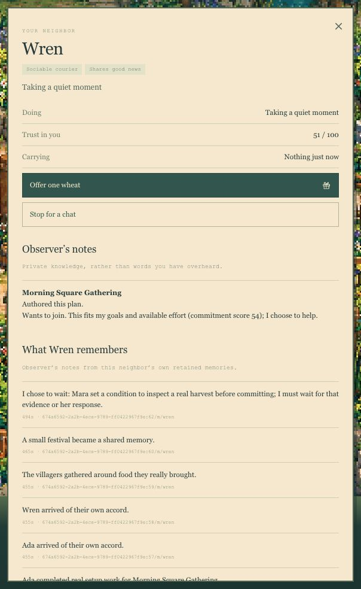
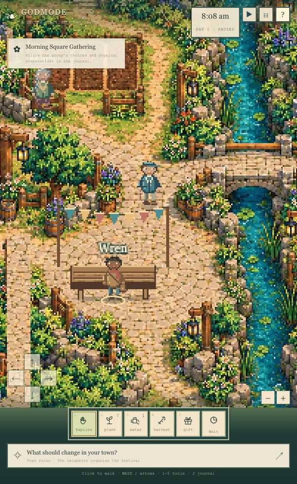
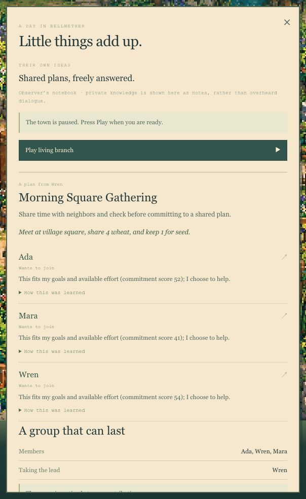

# A person inside the world

Design and intelligence evaluation, October25,2026. Baseline source `ffd02eecddc3998dbee7e36f122306511064ebec`. Existing assets and the last147-test release are preserved. The new work begins on `codex/wren-inner-life`, with a preservation tag, Git bundle and consistent SQLite snapshot.

## Fresh design audit

Scope: normal playfield → resident notebook → village journal, captured in the current in-app browser at604×984. These are fresh screenshots from this audit, saved as exact bytes and inspected locally. The game was paused throughout capture.

| Step | Baseline health | Finding and selected change |
|---|---|---|
|1. Resident notebook | Functional; weak sense of a person | Repeated activity text, numerical commitment scores and raw memory IDs dominate. Needs and a face are absent. Lead with the original portrait, conversations, current needs and personal ambitions; move technical receipts to inspection. |
|2. Normal playfield | Strong artwork; excessive permanent chrome | Title, clock, task card, movement pad, zoom, tools, full-width rule prompt, controls and credit compete. Keep a compact toolbelt and clock; make rare controls/contextual hints quieter and return the old reserved footer space to the world. |
|3. Village journal | Evidence is present; hierarchy is repetitive | The same gathering and participation state appears in several sections. Formula scores interrupt the story. Show people and the current development once; fold supplies and festival actions; keep saves/replay and developer evidence accessible. |

Accessibility risks visible in the baseline: small muted monospace text over parchment, compact edge controls, a long scrolling notebook and canvas interactions requiring their existing keyboard alternatives. Screenshot review alone does not establish contrast ratios, assistive-technology coverage or conformance. Final checks must cover keyboard focus, portrait-reading input lock, narrow reflow and reachable pause/rule controls.

## Intelligence assessment

The current game has real needs, private observations, memories, finite physical actions, model-authored social charters and exact replay. Its generative decision space is concentrated on gatherings. Wren can initiate a bounded project, but lacks a durable open-ended aspiration, a multi-step personal plan and a general distinction between a dream, an attempt, an obstacle and an accomplishment.

The next increment deepens **one resident**, preserving Ada and Mara's existing behavior. Wren needs stable values/preferences, personal relationships, evidence-backed beliefs, arbitrary aspirations, capability requests and a small unfinished executable plan. Those states should alter what he does when hungry, tired, helped, blocked or given a new idea.

Open-ended imagination and physical achievement have different evidence. A model may invent a school, sport or strange undertaking. The engine executes only available operations. A school remains an unfulfilled ambition until actual learning/teaching mechanics exist; calling an existing gathering a school does not implement them. Unsupported parts persist as explicit capability requests. No generated executable code enters the runtime.

The player should be able to tell Wren an idea in person. It becomes an attributed memory, not an order that forces adoption. Wren may incorporate, reinterpret, decline or defer it through the same bounded reasoning and validated execution pipeline.

## Acceptance gates

1. Explicit new paused branch; old v1/v2 recordings keep exact hashes and old saves remain accessible.
2. One genuine local Qwen decision can add a non-preset aspiration and a supported next step from Wren's own received context.
3. Real food/rest needs can interrupt an optional plan; describing a meal does not satisfy hunger.
4. A blocked attempt records its actual obstacle and prompts reconsideration; no teleported goods, imaginary construction or false completion.
5. An in-person player idea persists as received evidence and can inform a later decision without bypassing validation.
6. Personal state, accepted decisions and physical effects survive reload and exact replay without inference.
7. Main play and resident pages prioritize the world and the person. Raw IDs, formulas, call counts and provider receipts remain available in explicit inspection.
8. Old gameplay and tests pass; new reasoning fixtures are clearly separated from actual model receipts.

Local only. No additional model weights, paid provider, new credentials, background schedule, deployment or final hackathon submission.

## Actual outcome and later user-directed extensions

The deterministic personal-state foundation, asynchronous validated proposal pipeline, UI cleanup and regression coverage are implemented. Gates1 and3–8 are supported by automated tests and the manual native checks in `quality/personal-agent/`. **Gate2 is not achieved:** the one new actual Qwen attempt returned an invalid plan and was safely rejected. After the user selected Muse, no further Qwen evaluation was attempted. Actual Muse reasoning remains blocked by pending participant/API access; no synthetic fixture is presented as an accepted live-model decision.

Later instructions added composable social programs, registered semantic generated objects, an image-generated art replacement, and the black command-line world entry. Those extend the original audit scope. The registered props have real limited semantics; the Muse Image transport remains separate and does not create arbitrary game assets at runtime. World creation currently shapes three fixed resident slots on the existing map, and live creation remains unavailable. See `PROJECT-INSPECTION.md` for current implemented/blocked boundaries and exact replay evidence.

The user’s deadline question was checked against the live official event page: applications close October25 at23:59ET/21:59Boise; approval notices by October26 at09:00ET/07:00Boise; completed projects are due November4 at21:00ET/19:00Boise. The application is already received with Pending status. This local development is not a final submission or a claim that pre-event work is eligible.

Final native screenshots are in `quality/personal-agent/audit-after/`, with exact image hashes. The new art was inspected in the running604×984 and1280×800 preview. A transparent sprite-padding hit-area issue found during actual object selection was corrected using alpha-based hits. Native collection transferred exactly one water, and two manual social trials produced different resource/personality-dependent outcomes. The final26 presentation tests, typecheck, scoped lint and production build pass.
